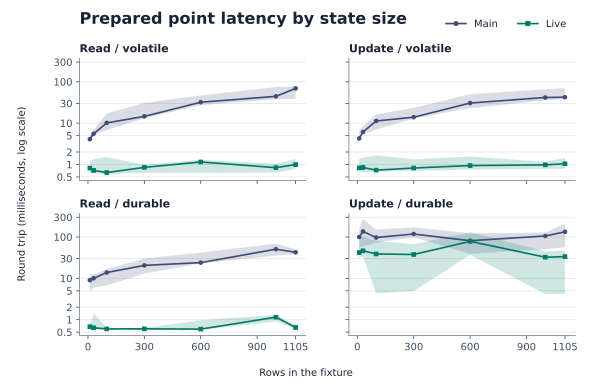

# Live engine benchmark

Main `e3f9dec116e2f4c376f5a24153b5636af81168d4` and experimental/live-engine `bc28ae2d157ffbca5409a02000509088fcc606a3`.
Fresh runs on 2026-11-19, 05:10:56–08:17:12 UTC. Setup, builds and measurements took **3 h 06 min 16 s**.

## Protocol

Each invocation held `/tmp/jaydb2-experiments-heavy.lock` and used the thesis fixed-clock wrapper with unlimited stack. Intel Core i7-11700K, 16 logical CPUs, performance governor and EPP, turbo disabled, nominal 3.6 GHz. One native thread per worker, inherited CPU affinity, GPU off, warm page cache and ext4 on `/dev/sda2` (Lexar 256 GB SSD). The clock policy was restored and verified after each invocation.

Both release builds used the same pinned Bend 2.0.39 toolchain. E2 ran live → main, E3 main → live, and E5 main/live → live/main → main/live. E2 and E3 kept three fresh sessions × 300 calls per cell after one warmup. E5 kept three ascending-size sessions × 50 calls per cell after one warmup. Values are pooled medians [inclusive Q1, Q3] unless specified. Ratios divide medians. Samples are retained in full.

The three thesis harness files match byte-for-byte. The launcher redirects saves and corrects storage descriptions in live JSON. Workloads, flags, checks and timed intervals use the original harness. Main used a detached worktree with the same toolchain and PostgreSQL binaries. Revision identity is recorded in `metadata.commit`, alongside binary and source fingerprints, pinned toolchain hashes and CPU snapshots. The audit records the execution order, raw file hashes and restoration receipts. [Audit](audit.json)

Raw files larger than 500 KB are stored xz-compressed; the audit hashes refer to the decompressed JSON.

Run each command from the live checkout using this wrapper.

```sh
flock /tmp/jaydb2-experiments-heavy.lock bash -c 'ulimit -s unlimited; exec paper/bench/fixed-clock.sh "$@"' bench python3 -B tools/live/bench/thesis.py prepared --output docs/evidence/live-engine/NEW.json
```

Use `--root /tmp/DETACHED-MAIN` for main. The supplementary invocations use `tools/live/bench/measure.py` with the same clock and lock wrapper.

## E2 prepared calls

Stdio framed request through receipt of the full reply, in ms. Original read, indexed and voucher fixtures, with checked voucher retirement outside each timed call. **n = 900 per cell and engine**.

| Program / storage | Main (ms) | Live (ms) | Main/live |
| --- | ---: | ---: | ---: |
| Read / volatile | 4.582 [4.136, 5.238] | 0.680 [0.639, 0.785] | 6.74× |
| Indexed / volatile | 7.466 [7.097, 8.220] | 2.640 [2.377, 3.096] | 2.83× |
| Voucher / volatile | 6.964 [6.456, 7.443] | 3.449 [2.979, 4.341] | 2.02× |
| Read / durable | 5.344 [4.749, 6.370] | 0.747 [0.653, 0.994] | 7.15× |
| Indexed / durable | 61.685 [20.644, 104.213] | 6.597 [5.705, 49.990] | 9.35× |
| Voucher / durable | 64.314 [40.000, 105.395] | 6.939 [5.980, 20.504] | 9.27× |

[Main E2](main-e2.json.xz) · [Live E2](live-e2.json.xz)

## E3 durable point operations

**n = 900 per cell and engine.** PostgreSQL 16.15 used fsync, synchronous_commit and full_page_writes. SQLite 3.45.1 used WAL/FULL. Both SQL references were remeasured in each invocation. The checked JayDB2 update acknowledgement was followed by untimed value readback. SQL returned the changed integer inside its timed execute/fetchall. The raw files also retain the owner workload, PostgreSQL RLS checks, SQLite cross-owner controls and JayDB2 altered-program certificate probes.

| Rows / operation | Main (ms) | Live (ms) | Main/live | PostgreSQL (ms), main run → live run | SQLite (ms), main run → live run |
| --- | ---: | ---: | ---: | ---: | ---: |
| 10 / read | 5.649 [5.100, 6.540] | 0.641 [0.610, 1.384] | 8.81× | 0.0430 [0.0420, 0.0471] → 0.0438 [0.0415, 0.0987] | 0.0030 [0.0030, 0.0031] → 0.0031 [0.0030, 0.0031] |
| 10 / update | 89.222 [73.853, 123.910] | 37.645 [4.416, 88.062] | 2.37× | 3.6540 [2.6044, 38.5439] → 7.8391 [3.2920, 40.3198] | 42.5267 [7.0122, 74.0714] → 41.2769 [6.9233, 58.5417] |
| 1,104 / read | 42.460 [37.760, 45.397] | 0.679 [0.622, 0.805] | 62.50× | 0.0447 [0.0429, 0.0473] → 0.0464 [0.0423, 0.0946] | 0.0034 [0.0032, 0.0057] → 0.0041 [0.0033, 0.0060] |
| 1,104 / update | 125.116 [91.921, 154.644] | 4.598 [3.617, 37.991] | 27.21× | 3.6595 [2.6089, 38.5372] → 30.9566 [3.4832, 39.0113] | 3.4950 [2.3561, 35.6303] → 3.6003 [2.4392, 37.7834] |

Live/SQL ratios from the live run were 10-row read 14.64× PostgreSQL and 209.96× SQLite, 10-row update 4.80× PostgreSQL and 0.91× SQLite, 1,104-row read 14.65× PostgreSQL and 164.16× SQLite, and 1,104-row update 0.15× PostgreSQL and 1.28× SQLite.

[Main E3](main-e3.json.xz) · [Live E3](live-e3.json.xz)

## E5 scaling to the state limit

Last-key calls, **n = 150 per cell, operation and engine**. The 65,536-byte configured ceiling allowed 1,105 rows (65,503 bytes) for this fixture. All excess-row attempts returned the limit result and the following read confirmed rollback. First-key reads at both endpoints are in the raw files.



### Volatile

| Rows | Main read (ms) | Live read (ms) | Main/live | Main update (ms) | Live update (ms) | Main/live |
| --- | ---: | ---: | ---: | ---: | ---: | ---: |
| 10 | 4.074 [3.983, 5.050] | 0.819 [0.640, 1.221] | 4.97× | 4.264 [4.055, 6.711] | 0.828 [0.686, 1.374] | 5.15× |
| 30 | 5.532 [5.100, 6.887] | 0.719 [0.622, 1.345] | 7.70× | 6.090 [5.356, 8.290] | 0.845 [0.639, 1.477] | 7.21× |
| 100 | 10.130 [6.788, 17.118] | 0.637 [0.589, 1.507] | 15.92× | 11.277 [6.969, 16.208] | 0.729 [0.674, 1.659] | 15.48× |
| 300 | 14.555 [13.069, 30.842] | 0.851 [0.631, 0.984] | 17.10× | 13.911 [12.978, 23.414] | 0.821 [0.701, 1.335] | 16.95× |
| 600 | 32.057 [27.299, 46.759] | 1.150 [0.627, 1.296] | 27.88× | 30.632 [22.970, 50.078] | 0.942 [0.754, 1.559] | 32.53× |
| 1,000 | 44.421 [37.712, 74.636] | 0.837 [0.639, 1.037] | 53.06× | 41.689 [35.776, 65.672] | 0.979 [0.782, 1.155] | 42.60× |
| 1,105 | 69.183 [38.573, 77.288] | 0.993 [0.770, 1.344] | 69.70× | 42.343 [38.292, 70.303] | 1.041 [0.794, 1.459] | 40.68× |

### Durable

| Rows | Main read (ms) | Live read (ms) | Main/live | Main update (ms) | Live update (ms) | Main/live |
| --- | ---: | ---: | ---: | ---: | ---: | ---: |
| 10 | 9.010 [4.709, 12.458] | 0.678 [0.635, 0.727] | 13.29× | 99.820 [55.145, 156.160] | 42.090 [32.112, 85.737] | 2.37× |
| 30 | 10.013 [6.024, 12.563] | 0.636 [0.568, 1.440] | 15.74× | 136.215 [59.094, 272.715] | 46.353 [33.642, 100.853] | 2.94× |
| 100 | 13.839 [6.752, 16.543] | 0.599 [0.575, 0.624] | 23.12× | 97.072 [72.892, 150.816] | 38.874 [4.335, 80.074] | 2.50× |
| 300 | 20.556 [13.007, 30.151] | 0.601 [0.574, 0.632] | 34.22× | 118.030 [98.682, 171.202] | 37.706 [4.909, 66.929] | 3.13× |
| 600 | 23.978 [23.102, 41.862] | 0.591 [0.561, 0.973] | 40.56× | 81.164 [38.979, 122.502] | 78.405 [37.040, 130.561] | 1.04× |
| 1,000 | 50.704 [35.575, 69.108] | 1.151 [0.901, 1.301] | 44.05× | 105.750 [50.877, 128.350] | 32.396 [4.158, 45.081] | 3.26× |
| 1,105 | 42.562 [38.321, 50.057] | 0.647 [0.605, 0.741] | 65.79× | 133.151 [56.226, 208.426] | 33.500 [4.220, 46.118] | 3.97× |

[Main E5 #1](main-e5-1.json.xz) · [Main E5 #2](main-e5-2.json.xz) · [Main E5 #3](main-e5-3.json.xz) · [Live E5 #1](live-e5-1.json.xz) · [Live E5 #2](live-e5-2.json.xz) · [Live E5 #3](live-e5-3.json.xz)

## Cold prepare and startup

Cold prepare times measure a fresh checked compilation and registration while the service is running. Each E2 session registered three times and invalidated the handle between registrations. Startup samples used 10-row stdio fixtures, from launching a fresh service through a checked authentication-denial reply. Durable startup created a fresh database.

| Operation / storage | Main (s) | Live (s) | Main/live | n each |
| --- | ---: | ---: | ---: | ---: |
| Prepare read / volatile | 8.26 [7.96, 9.81] | 7.25 [6.69, 10.73] | 1.14× | 9 |
| Prepare indexed / volatile | 13.31 [12.91, 14.47] | 16.17 [14.53, 21.02] | 0.82× | 9 |
| Prepare voucher / volatile | 12.34 [11.92, 12.80] | 14.44 [14.17, 23.49] | 0.85× | 9 |
| Startup / volatile | 13.33 [12.39, 13.44] | 13.05 [12.87, 15.94] | 1.02× | 5 |
| Prepare read / durable | 7.90 [7.79, 8.84] | 10.11 [8.66, 10.83] | 0.78× | 9 |
| Prepare indexed / durable | 12.86 [11.86, 13.35] | 13.25 [12.37, 14.03] | 0.97× | 9 |
| Prepare voucher / durable | 14.27 [12.46, 14.42] | 12.67 [10.09, 13.53] | 1.13× | 9 |
| Startup / durable | 14.40 [13.29, 15.17] | 13.35 [12.44, 14.63] | 1.08× | 5 |

[Startup samples](startup.json)

## Live Unix-socket throughput

Durable create with the listener benchmark fixture, 19 rows, one native thread per worker and up to 16 active requests. Clients used separate keys and one in-flight operation per connection. Each of five fresh services ran rotated conditions with 2,000 reads or 256 durable increments per connection after eight warmups. Rate quartiles use the five trial rates. The timing observer was enabled to count WAL batches. All replies and final values were checked.

| Connections | Reads/s | Updates/s | Writes per WAL sync, median trial | Trials |
| --- | ---: | ---: | ---: | ---: |
| 1 | 516 [476, 577] | 23 [23, 38] | 1.00 | 5 each |
| 4 | 2,073 [1,987, 2,093] | 41 [40, 50] | 1.92 | 5 each |
| 16 | 2,996 [2,855, 3,383] | 124 [120, 146] | 7.12 | 5 each |

[Listener trials](throughput.json.xz)

## Disk and CPU

Raw syncs rewrote initialized extents on the database filesystem. Each sample issued a buffered pwrite and immediately timed fdatasync. Three files per write size, each with five warmups and 100 samples. The baseline excludes WAL encoding, filesystem directory updates and application work. The sync probe ran in its own fixed-clock invocation.

| Bytes dirtied | fdatasync (ms) | pwrite + fdatasync (ms) | n |
| --- | ---: | ---: | ---: |
| 256 | 50.017 [37.315, 85.465] | 50.547 [37.530, 86.480] | 300 |
| 4096 | 37.660 [4.537, 66.735] | 37.765 [4.613, 72.369] | 300 |

Separate live volatile read probe. CPU values are CPU time per call from five batches of 300 on one persistent worker per size. Phase and round-trip medians pool the 1,500 instrumented requests per size.

| Rows | Worker CPU (ms) | Host CPU (ms) | Worker phase (ms) | Round trip (ms) |
| --- | ---: | ---: | ---: | ---: |
| 10 | 0.539 [0.528, 0.549] | 0.096 [0.095, 0.106] | 0.570 [0.560, 0.583] | 0.674 [0.648, 0.712] |
| 1,105 | 0.534 [0.533, 0.535] | 0.100 [0.098, 0.104] | 0.576 [0.569, 0.580] | 0.672 [0.652, 0.689] |

[Raw syncs](fdatasync.json) · [Worker CPU and phases](worker.json.xz)

## Interpretation

- Publication was the largest phase in the durable Indexed workload, with medians of 53.366 ms on main and 3.732 ms on live. Main syncs a new complete image and its directory entry. Live syncs WAL batches and checkpoints separately. The raw probe spent most of its time in fdatasync, and the range of serial update results shows how much storage latency varied across sampling windows. Concurrent live writers amortized syncs through WAL batching.

- The checked worker consumed about 92% and 93% of measured worker-phase wall time at 10 and 1,105 rows. The worker phase includes checked dispatch, authentication, program execution and its IPC with the live store. Read-only listener requests had zero WAL writes. Main sends and decodes the canonical state per call, while the live store mediates point operations and reuses the checked worker. Scheduler and IPC time remain in the phase interval.

- Other build and test processes were active during early live E2. The heavy lock serialized benchmark invocations. The audit contains intermittent host load and I/O pressure samples for judging cross-run variation. Pooled quartiles describe the distribution observed on this machine.
- Live 10-row point update session medians were 117.377, 31.021 and 4.416 ms.
- PostgreSQL’s 10-row owner update session medians in the main run were 53.972, 3.621 and 3.903 ms.
