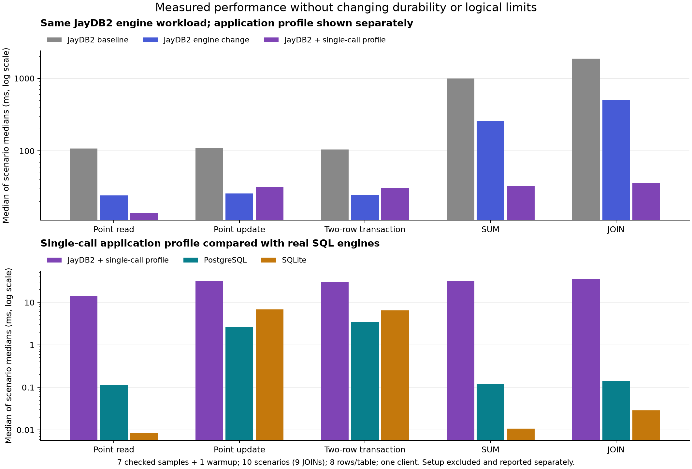

# Verified performance improvements

The original ten-scenario benchmark is retained unchanged as a historical
report. This follow-up starts from engine revision `441f807` plus that saved
suite and uses separate frozen baseline/candidate checkouts. All 90 databases
in the baseline, engine and query-profile runs passed. Runs finished on
6–7 November 2026 UTC; this report was finalized after resuming on 9 November.
JayDB2 became substantially faster, but it does **not** beat PostgreSQL or
SQLite overall in these workloads. The strict setup gates have losses, retained
below rather than described as a regression-free result.

## Implemented changes and preserved behavior

The original `Bytes.nat64` converts a natural through one predecessor step per
unit. `Input.parts` previously performed that conversion on the configured
state and message ceilings in every authentication and execution worker. The
8 MiB ceiling therefore caused millions of conversion steps even with tiny
stored data. The benchmark keeps that same ceiling.

`FastBytes.nat64_checked` uses the official U32 conversion and an exact natural
roundtrip guard. Values through `U32::MAX` use the short native path; larger
values try a two-word candidate checked against its exact fixed-width natural
measure. Values outside these guarded paths use a tail-recursive conversion.
The checked shortcuts and tail fallback are proved equal to the original for every natural,
including overflow. No arithmetic axiom, compiler change, truncated comparison,
cached answer or smaller logical limit is introduced.

`OptimizedInput` changes only the conversion used in input composition. Checked
theorems establish exact equality of parts, decode, analyze and private
authentication output to the original input machine for every packet, schema
and limits, without valid-input or credential assumptions. Native ordinary,
prepared and read-only entries use this equivalent input route. The original
contract and eight-law model functions remain unchanged. Rust, Node, C, the
official compiler/runtime, OS and storage assumptions retain their documented
trusted-boundary status.

Explicitly read-only-certified prepared requests now use the existing pinned
durable-root path with one reader as well as multiple readers. This remains
serial with one reader. It preserves fresh authentication, sealed artifacts,
native execution, changed-state rejection, response pairing and FIFO barriers.
Ordinary and write-capable requests retain their original publication path.

An additional `single-call-queries-v1` application profile executes generic SUM
and child-parent JOIN inside one certified transaction instead of nine or
seventeen requests. Actual key lists drive both traversal and termination;
there is no eight-row bound or cached data. Its Reader and validation program
have genuine read-only certificates; SUM/JOIN retain ordinary admission with
actual-state termination. All six program preparation costs remain measured.
This profile is reported separately from the engine-only comparison.

## Measured results

All 49 JayDB2 scenario/workload medians improved in the engine comparison, with
paired workload speedups of **4.23–4.86×**. Every corresponding median in the
separate application-profile comparison also improved over baseline; its
point-read, SUM and JOIN paired median speedups were **8.82×, 33.13× and
58.32×**. This second comparison combines the engine changes and a different
application access strategy.

| Workload | Jay baseline ms | Jay engine ms | Paired speedup | Jay single-call ms | Paired speedup | PostgreSQL ms | SQLite ms |
| --- | ---: | ---: | ---: | ---: | ---: | ---: | ---: |
| Point read | 107.674 | 24.280 | 4.86× | 14.145 | 8.82× | 0.1118 | 0.0085 |
| Point update | 110.616 | 25.885 | 4.33× | 31.575 | 3.96× | 2.6935 | 6.8775 |
| Two-row transaction | 104.377 | 24.584 | 4.47× | 30.705 | 3.83× | 3.4363 | 6.4815 |
| SUM | 998.669 | 256.389 | 4.42× | 32.520 | 33.13× | 0.1228 | 0.0108 |
| JOIN | 1876.728 | 500.636 | 4.23× | 36.138 | 58.32× | 0.1421 | 0.0289 |

Latency columns are unweighted medians of per-scenario medians, in milliseconds.
Speedups are medians of paired scenario ratios; they are not the ratio of the
adjacent aggregate columns. PostgreSQL/SQLite columns come from the query-profile
run, with unchanged SQL adapters. [Every engine-run SQL measurement](evidence/performance/candidate/summary.csv)
and [every query-profile measurement](evidence/performance/query/summary.csv)
remain available.



The engine run beat PostgreSQL in only two individual durable-write medians and
SQLite in two two-row transaction medians; all other paired medians were slower.
The single-call profile beat neither rival in any of its 49 paired medians.
These isolated write observations are not evidence of a general advantage.
Native SQL still has much lower read/query latency. The remaining fresh-worker,
full-state and certification costs need separate profiling and preservation
arguments before more architectural changes.

### Setup and resource costs

| JayDB2 metric | Baseline | Engine change | Single-call profile |
| --- | ---: | ---: | ---: |
| Create schema/client and prepare, seconds | 24.628 | 25.825 | 46.979 |
| Populate, seconds | 14.740 | 2.885 | 4.018 |
| Reopen and prepare, seconds | 24.369 | 24.391 | 44.750 |
| Observed peak process-tree RSS, MiB | 70.760 | 7.625 | 11.230 |
| Live/closed snapshot size, KiB | 15.232 | 15.232 | 15.232 |

Each entry is a median across ten scenarios, not a per-row cost. Population
varies with schema size. Snapshot size is identical across runs for each
scenario. RSS is an observed 10 ms sample maximum during workload execution;
shorter workers may be missed more often after optimization, so these numbers
do not establish a memory bound or independently attribute allocations.

The additional profile prepares six programs instead of three, adding a real
setup/reopen cost. It is an explicit opt-in profile; the saved legacy benchmark
and normal service preparation API retain their original behavior. It must not
be promoted as an improvement in every dimension.

### Regression gates and follow-up

The preselected engineering thresholds were 5% noise classification and a 15%
regression threshold. Both [engine latency](evidence/performance/compare-engine-latency/comparison.md)
and [application-profile latency](evidence/performance/compare-query-latency/comparison.md)
gates pass: 49/49 medians improve in each, with no functional failures or
changed duplicate-key/foreign-key behavior. All nine final data hashes per
scenario (three engines × three runs) agree.

The [strict engine latency/setup gate](evidence/performance/compare-engine-all/comparison.md)
**fails** four single-observation setup cases:

| Scenario | Metric | Original observed slowdown |
| --- | --- | ---: |
| Personal tasks | Reopen and prepare | 25.50% |
| Household budget | Create and prepare | 20.75% |
| Editorial blog | Reopen and prepare | 16.63% |
| Ecommerce | Create and prepare | 22.87% |

The [strict query-profile gate](evidence/performance/compare-query-all/comparison.md)
also fails, with 20 setup/population observations over threshold, dominated by
the six-program preparation cost. Its raw observations remain visible.

A [direct engine-to-query comparison](evidence/performance/compare-engine-query/comparison.md)
also retains mixed write timings: three point-update scenarios and four two-row
transaction scenarios slow by more than 15% between those sequential runs.
Their absolute aggregate medians are visible in the table above. The paired
median changes are -6.68% and -2.29%, respectively, so the data do not support
attributing a uniform write penalty or claiming a uniform profile improvement.
The optional profile is useful for fewer read/query requests, with measured
setup and write-variability tradeoffs.

Setup has only one observation per scenario in the original full runs, so it
cannot establish whether those four engine-only flags are systematic. A
[three-pair interleaved follow-up](evidence/performance/setup-followup/README.md)
confirmed all four costs: every one of the twelve pairs was slower. Median
paired changes were +15.93% (tasks reopen), +20.83% (budget create), +17.24%
(blog reopen) and +29.11% (ecommerce create). All 24 observations passed actual
preparation, copied-snapshot readback where applicable, and original input,
source and binary guards. The failed original gate is preserved.

Matched generated C grew by approximately 54 KiB after adding the conversion
helpers. This supports investigating compilation footprint, but does not prove
per-phase causality. A smaller scalar-measure variant is under separate proof,
native and setup validation; it is not the measured candidate in these tables.

## Validation

All full release targets completed successfully across recorded segments.
The first `make check-release` and its first continuation ended by SIGTERM;
neither logged a failed assertion. The remaining targets were resumed at the
same engine bytes and completed with exit 0. This is full target coverage,
not a claim of one uninterrupted successful `make check-release` invocation.
[Validation metadata and logs](evidence/performance/validation/validation.json)
record the exact source identity and execution history.

Validation includes both official proof modes for the contract, implementation,
library and idempotency roots; proof negative controls; native boundary checks
through the supported 48-bit Nat domain; 44 Rust tests, formatting and clippy;
20 native service integration tests; 25 SQL/Drizzle checks; TypeScript and starter
flows; 17 generic query edge checks; thousands of library arithmetic/collection
cases; restricted-user indexed/task/receipt applications; nine fault/recovery
tests; and seven web-demo integration tests. The 30 benchmark/comparator tests
and five profile-wrapper tests also pass. No functional regression was found.

[Two independent reviews](evidence/performance/review-notes.md) checked the proof
bridges, host boundaries and measurement fairness. The candidate engine/tool/
proof bytes match tested revision `183042e`; later changes are reporting tools,
documentation and evidence. Passing finite tests and sampled gates cannot prove
the absence of every possible regression. The setup flags above prevent an
unqualified claim of zero observed performance regressions.

The benchmark is retained with canonical fixtures, materialized project sources,
raw checked samples, source/tool identities, Make targets, and smoke/full CI
fixture checks. Reuse it with:

```sh
make test-database-benchmark
make benchmark-databases BENCHMARK_OUTPUT=build/my-comparison
python3 experiments/database-comparison/compare.py \
  build/before/result.json build/after/result.json \
  --engines jaydb2 --gate-metrics latency setup --output build/my-gate
```

Keep matching binaries and frozen baseline/candidate checkouts. See the
[reproduction guide](README.md#reuse-as-a-performance-regression-benchmark),
[raw baseline](evidence/performance/baseline/results.json),
[raw candidate](evidence/performance/candidate/results.json),
[raw query profile](evidence/performance/query/results.json), and
[combined analysis](evidence/performance/summary/combined-analysis.json).

## Measurement controls

Three complete runs use the same ten schema/data fixtures and the same oracle:
1/3/5/8/10/12/15/18/22/26 tables, eight rows per table, seven measured samples
and one warmup per workload, one client, one native thread and one reader.
The five workflows cover point reads, point updates, atomic two-row updates,
SUM and the nine applicable child-parent JOINs. Each timed result is checked
recursively with exact types. Every final cell is checked after reopening;
PostgreSQL also undergoes a complete private-cluster restart.

The baseline uses engine revision `441f807` plus the saved benchmark. The engine
candidate keeps the original measured adapter and programs. The additional
query-profile run changes only the explicitly recorded application strategy.
Its comparisons require `--allow-workload-change`; its preparation costs must
not be attributed to an isolated engine improvement.

All three use durable writes and the original 8 MiB state, 256 KiB message and
256 KiB response ceilings. PostgreSQL uses synchronous commit/fsync and SQLite
uses STRICT tables, WAL/FULL and real foreign keys. JayDB2 continues fresh
native workers, fresh authentication, actual source-bound proof admission and
sealed artifact verification. The common heavy-work lock serializes native
validation and measurements, but cannot control unrelated machine activity.

The report aggregates an unweighted median of each scenario's sample median.
A paired speedup is computed separately for each matching scenario, then its
median is reported. Those two aggregations need not have identical ratios.
Every scenario/workload and setup observation remains in the comparison files.
There is no adjustable composite score. Seven-sample nearest-rank p95 is the
sample maximum, not a reliable population tail estimate.

## Costs and limits to retain

This is a schema-feasibility and access-path study, not a large-data scaling or
concurrent-throughput benchmark. Tiny data favors fixed-cost analysis and does
not establish performance at the configured state ceiling. Setup, compilation,
initial population and reopen preparation are measured separately from warmed
workload calls. Setup has one observation per scenario, so individual changes
need cautious interpretation under changing host load.

The additional application profile prepares six programs instead of three.
Its SUM/JOIN programs have actual-observation termination and universal Free
policy certificates; those certificates do not prove query-result mathematics
or supply arbitrary application laws. Native edge-case checks and independent
benchmark oracles verify actual outputs. Intermediate signed64 SUM overflow
refuses, whereas PostgreSQL SUM(bigint) uses a numeric accumulator. All fixture
sums fit the common signed64 subset.

JayDB2's benchmark configuration installs no business or permission laws.
SQL foreign keys therefore remain stronger than this JayDB2 configuration,
and DefineRow retains its existing replacement behavior rather than strict
INSERT behavior. These differences are exposed by negative probes and are
unchanged by the optimization. Existing restricted-user application tests
remain part of validation.

The native Nat domain remains 48 bits, independent of full two-word signed64
stored values. The fast conversion is logically equal for every natural;
native boundary tests cover the supported domain. Initial configuration
validation still follows its existing startup path. The singleton certified
read path uses the existing batch observer/timing events, including
`read_batch: true`; it omits the former serial prepared-resolution intermediate
inspector event. Public response, authentication and FIFO behavior are retained.

RSS is sampled every 10 ms and may miss short peaks; summed process-tree RSS
counts shared pages repeatedly. Engine process scopes and storage accounting
also differ. Neither sampled RSS nor disk size alone supports an efficiency
ranking. The exact executable/environment is part of a JayDB2 durable database;
retain each run's matching executable and do not treat a newer build as a
supported migration.

## Further work that needs its own design and evidence

After these changes, useful candidates include profiling the remaining worker
startup and state-codec costs, proving indexed lookup implementations, and
extending read-only certification to actual-observation traversals. Each needs
measured evidence and its own preservation argument. This change does not skip
authentication, cache identity or results, weaken artifact checks, lower limits,
change the official compiler/runtime, or introduce long-lived workers. No
claim that JayDB2 beats the SQL engines follows from a JayDB2-only improvement.
