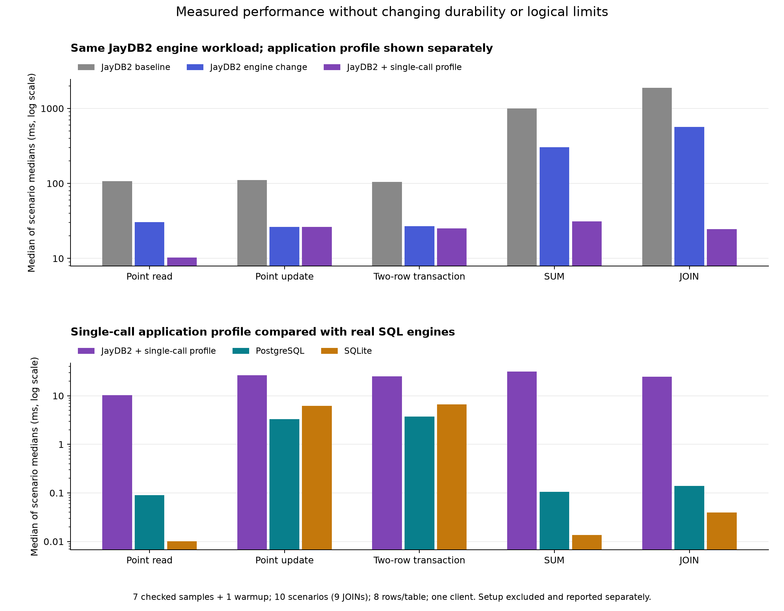

# Verified performance improvements

The reusable benchmark and measured optimizations are saved on
`perf/certified-runtime-performance`. The final scalar engine revision is
`72245d4`. Its complete `make check-release` passed before both final database
runs. The original engine anchor is `441f807`; the frozen measured baseline is
`3dbde8d` with the same exact-type benchmark oracle. Workload latency improved
substantially, but JayDB2 still loses most SQL comparisons and the strict
performance gates retain regressions. This is **not** a regression-free or
SQL-beating result; no functional failure was found in full release validation.

## Implemented changes and preserved behavior

The original `Bytes.nat64` converts a natural through one predecessor step per
unit. `Input.parts` previously performed that conversion on the configured
state and message ceilings in every authentication and execution worker. The
8 MiB ceiling therefore caused millions of conversion steps even with tiny
stored data. The benchmark keeps that same ceiling.

`FastBytes.nat64_checked` uses the official U32 conversion and an exact natural
roundtrip guard. Values through `U32::MAX` use the short native path; larger
values try a two-word candidate checked against its exact fixed-width natural
measure. Values outside these guarded paths use a tail-recursive conversion.
The checked shortcuts and tail fallback are proved equal to the original for every natural,
including overflow. No arithmetic axiom, compiler change, truncated comparison,
cached answer or smaller logical limit is introduced.

`OptimizedInput` changes only the conversion used in input composition. Checked
theorems establish exact equality of parts, decode, analyze and private
authentication output to the original input machine for every packet, schema
and limits, without valid-input or credential assumptions. Native ordinary,
prepared and read-only entries use this equivalent input route. The original
contract and eight-law model functions remain unchanged. Rust, Node, C, the
official compiler/runtime, OS and storage assumptions retain their documented
trusted-boundary status.

Explicitly read-only-certified prepared requests now use the existing pinned
durable-root path with one reader as well as multiple readers. This remains
serial with one reader. It preserves fresh authentication, sealed artifacts,
native execution, changed-state rejection, response pairing and FIFO barriers.
Ordinary and write-capable requests retain their original publication path.

An additional `single-call-queries-v1` application profile executes generic SUM
and child-parent JOIN inside one certified transaction instead of nine or
seventeen requests. Actual key lists drive both traversal and termination;
there is no eight-row bound or cached data. Its Reader and validation program
have genuine read-only certificates; SUM/JOIN retain ordinary admission with
actual-state termination. All six program preparation costs remain measured.
This profile is reported separately from the engine-only comparison.

The final refinement computes a candidate's natural measure as its low word
plus 32 doublings of its high word. A checked all-Nat theorem equates this to
the original codec's structural word measure. Native candidate intermediates
fit the existing 48-bit Nat domain; stored signed64 values retain their two-word
representation. This reduces compiled code growth without dropping wide
conversion or altering the official compiler/runtime.

## Final measurements

| Workload | Jay baseline ms | Jay engine ms | Paired speedup | Jay single-call ms | Paired speedup | PostgreSQL ms | SQLite ms |
| --- | ---: | ---: | ---: | ---: | ---: | ---: | ---: |
| Point read | 107.674 | 30.552 | 3.51× | 10.250 | 11.74× | 0.0893 | 0.0100 |
| Point update | 110.616 | 26.308 | 4.16× | 26.462 | 4.26× | 3.3145 | 6.2066 |
| Two-row transaction | 104.377 | 27.054 | 3.91× | 25.132 | 4.36× | 3.7196 | 6.5926 |
| SUM | 998.669 | 303.991 | 3.09× | 31.314 | 40.23× | 0.1055 | 0.0136 |
| JOIN | 1876.728 | 565.692 | 3.34× | 24.571 | 74.47× | 0.1396 | 0.0394 |

Times are milliseconds, aggregated as an unweighted median of scenario medians.
Paired speedups are medians of per-scenario ratios, so they need not equal the
ratio of adjacent aggregate columns. SQL columns come from the same final
query-profile run. JOIN covers nine scenarios; other workloads cover ten.



JayDB2 engine run: **2/49** paired workload medians faster than PostgreSQL.

JayDB2 engine run: **3/49** paired workload medians faster than SQLite.

JayDB2 query run: **0/49** paired workload medians faster than PostgreSQL.

JayDB2 query run: **0/49** paired workload medians faster than SQLite.

These observations do not establish that JayDB2 beats SQL overall. Its
fresh workers, authentication, proof-bound execution and durable publication
remain in place; SQL read/query latency remains a substantial comparison point.

## Setup and resources

| JayDB2 metric | Baseline | Final engine | Final query profile |
| --- | ---: | ---: | ---: |
| Create/client preparation, seconds | 24.628 | 30.804 | 41.550 |
| Populate, seconds | 14.740 | 2.454 | 2.450 |
| Reopen/preparation, seconds | 24.369 | 31.174 | 40.796 |
| Observed peak tree RSS, MiB | 70.760 | 7.605 | 12.746 |
| Live snapshot, KiB | 15.232 | 15.232 | 15.232 |

Each value is a median across scenarios, not a per-row cost. Setup has one
observation per scenario. RSS is sampled every 10 ms during workloads and may
miss short worker peaks; scopes and shared-page accounting prevent a simple
cross-engine memory ranking. All paired observations remain in raw evidence.

## Regression gates

Thresholds were fixed before measurement: 5% noise classification and 15%
regression threshold. Finite sampled gates cannot prove zero regressions.

- [engine-all](evidence/performance/compare-final-engine-all/comparison.md): **gate_failed**, 16 observations above threshold, 0 functional failures, 0 integrity-behavior changes.
- [engine-latency](evidence/performance/compare-final-engine-latency/comparison.md): **gate_passed**, 0 observations above threshold, 0 functional failures, 0 integrity-behavior changes.
- [query-all](evidence/performance/compare-final-query-all/comparison.md): **gate_failed**, 19 observations above threshold, 0 functional failures, 0 integrity-behavior changes.
- [query-latency](evidence/performance/compare-final-query-latency/comparison.md): **gate_failed**, 1 observation above threshold, 0 functional failures, 0 integrity-behavior changes.
- [engine-query](evidence/performance/compare-final-engine-query/comparison.md): **gate_failed**, 21 observation above threshold, 0 functional failures, 0 integrity-behavior changes.

The engine-only comparison improves all 49 workload medians, with paired
workload speedups of 3.09–4.16×. Its 16 threshold regressions are setup timings.
The application profile has one latency regression against baseline:
**ecommerce point update +23.49%**. Its aggregate gains must not hide this loss.

The application profile changes the access strategy and prepares six programs
instead of three. Additional preparation is a real cost; mixed write timings
remain observations, not evidence of a uniform causal penalty or benefit.
Neither comparison establishes a universal win.
Every flagged observation is retained in the linked comparisons.

Host load differed materially. The baseline's one-minute load average was
4.22→6.52; the final engine run's was 8.14→10.05, and the query run's was
10.76→2.93. These sequential runs cannot isolate every timing change from host
activity. This uncertainty does not erase failed gates or establish zero
regressions. The closely interleaved setup diagnostics provide separate,
limited evidence for the scalar refinement.

## Why the implementation was refined

The first Word-measure candidate improved every workload median but reproduced
setup slowdowns in all twelve follow-up pairs: median paired costs +15.93%,
+20.83%, +17.24% and +29.11% in the four flagged cases. That candidate and its
failed gates remain in [the first report](PERFORMANCE-WORD-CANDIDATE.md).

Scalar measurement reduced observed generated-C growth from about 54 KiB to
7.7 KiB. Three paired create tests each for budget and ecommerce then had
median paired changes +5.56% and +2.84%, with no pair above 15%. These short
prototypes justified the refinement, not a zero-overhead claim. Fresh full
release and final 30-database runs validate the promoted implementation.

## Validation and retained evidence

[The final full-release log and source identity](evidence/performance/final-validation/validation.json)
record one successful `make check-release` invocation at the frozen scalar
revision. It covers both official proof modes, negative controls, native numeric
boundaries, Rust checks, SQL/Drizzle and TypeScript clients, starter/task/indexed/
receipt applications, 20 service tests, nine recovery tests, and seven web tests.
No test failure was bypassed or converted into an assumed final-validity check.

The five primary benchmark runs contain 150 real databases and 5,145 measured
samples, all passed. The [all-runs audit](evidence/performance/all-runs-audit.json)
recomputed checked summaries, verified retained suite snapshots, matched engine
source to recorded commits and binaries to their hashes, and checked every
final-data file. All fifteen final-data hashes agree per scenario. Canonical
fixtures, exact-type outputs, full readback and source/tool guards remain
checked. Run dates, host load and versions are recorded
in each manifest. Sequential host-load variation is not statistical proof of
causality or population tail latency.

[Final engine raw data](evidence/performance/final-engine/results.json),
[final query raw data](evidence/performance/final-query/results.json),
[combined analysis](evidence/performance/final-summary/combined-analysis.json),
[first setup follow-up](evidence/performance/setup-followup/README.md), and
[scalar prototype setup](evidence/performance/scalar-setup/README.md) preserve
the measurement history. Keep each frozen checkout and its matching executable;
exact-environment durable reopening is unchanged.

Reuse the suite with:

```sh
make test-database-benchmark
make benchmark-databases BENCHMARK_OUTPUT=build/my-run
python3 experiments/database-comparison/compare.py \
  build/before/result.json build/after/result.json \
  --engines jaydb2 --gate-metrics latency setup --output build/my-gate
```

## Measurement controls

The three runs in the final comparison use the same ten schema/data fixtures
and oracle; the two earlier candidates are retained separately:
1/3/5/8/10/12/15/18/22/26 tables, eight rows per table, seven measured samples
and one warmup per workload, one client, one native thread and one reader.
The five workflows cover point reads, point updates, atomic two-row updates,
SUM and the nine applicable child-parent JOINs. Each timed result is checked
recursively with exact types. Every final cell is checked after reopening;
PostgreSQL also undergoes a complete private-cluster restart.

The baseline uses engine revision `441f807` plus the saved benchmark. The engine
candidate keeps the original measured adapter and programs. The additional
query-profile run changes only the explicitly recorded application strategy.
Its comparisons require `--allow-workload-change`; its preparation costs must
not be attributed to an isolated engine improvement.

All three use durable writes and the original 8 MiB state, 256 KiB message and
256 KiB response ceilings. PostgreSQL uses synchronous commit/fsync and SQLite
uses STRICT tables, WAL/FULL and real foreign keys. JayDB2 continues fresh
native workers, fresh authentication, actual source-bound proof admission and
sealed artifact verification. The common heavy-work lock serializes native
validation and measurements, but cannot control unrelated machine activity.

The report aggregates an unweighted median of each scenario's sample median.
A paired speedup is computed separately for each matching scenario, then its
median is reported. Those two aggregations need not have identical ratios.
Every scenario/workload and setup observation remains in the comparison files.
There is no adjustable composite score. Seven-sample nearest-rank p95 is the
sample maximum, not a reliable population tail estimate.

## Costs and limits to retain

This is a schema-feasibility and access-path study, not a large-data scaling or
concurrent-throughput benchmark. Tiny data favors fixed-cost analysis and does
not establish performance at the configured state ceiling. Setup, compilation,
initial population and reopen preparation are measured separately from warmed
workload calls. Setup has one observation per scenario, so individual changes
need cautious interpretation under changing host load.

The additional application profile prepares six programs instead of three.
Its SUM/JOIN programs have actual-observation termination and universal Free
policy certificates; those certificates do not prove query-result mathematics
or supply arbitrary application laws. Native edge-case checks and independent
benchmark oracles verify actual outputs. Intermediate signed64 SUM overflow
refuses, whereas PostgreSQL SUM(bigint) uses a numeric accumulator. All fixture
sums fit the common signed64 subset.

JayDB2's benchmark configuration installs no business or permission laws.
SQL foreign keys therefore remain stronger than this JayDB2 configuration,
and DefineRow retains its existing replacement behavior rather than strict
INSERT behavior. These differences are exposed by negative probes and are
unchanged by the optimization. Existing restricted-user application tests
remain part of validation.

The native Nat domain remains 48 bits, independent of full two-word signed64
stored values. The fast conversion is logically equal for every natural;
native boundary tests cover the supported domain. Initial configuration
validation still follows its existing startup path. The singleton certified
read path uses the existing batch observer/timing events, including
`read_batch: true`; it omits the former serial prepared-resolution intermediate
inspector event. Public response, authentication and FIFO behavior are retained.

RSS is sampled every 10 ms and may miss short peaks; summed process-tree RSS
counts shared pages repeatedly. Engine process scopes and storage accounting
also differ. Neither sampled RSS nor disk size alone supports an efficiency
ranking. The exact executable/environment is part of a JayDB2 durable database;
retain each run's matching executable and do not treat a newer build as a
supported migration.

## Further work that needs its own design and evidence

After these changes, useful candidates include profiling the remaining worker
startup and state-codec costs, proving indexed lookup implementations, and
extending read-only certification to actual-observation traversals. Each needs
measured evidence and its own preservation argument. This change does not skip
authentication, cache identity or results, weaken artifact checks, lower limits,
change the official compiler/runtime, or introduce long-lived workers. No
claim that JayDB2 beats the SQL engines follows from a JayDB2-only improvement.
