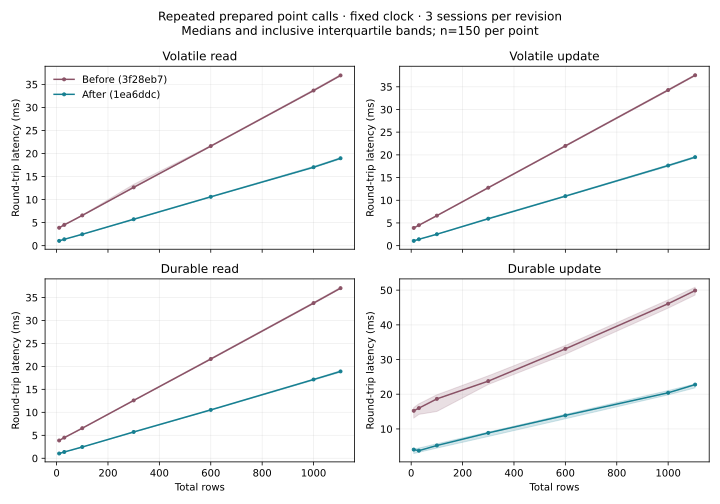

# Final fixed-clock repeated-program benchmark

Before: `3f28eb7c69d5da06b2bfe89ce3d720ed6d581acc`. After: `1ea6ddc7f76b0efc6cf5220b88628a1963339ad7` (the integrated `perf/repeated-programs` source). The evidence branch adds only benchmark drivers, raw observations and this report. No engine, host, proof, compiler, emitted C or runtime was edited.

## Measured outcome

Durable point read: 10 rows **3.8691 → 1.0396 ms**, JayDB2/PostgreSQL **91.57× → 25.03×**; 1,104 rows **36.8372 → 18.8280 ms**, JayDB2/PostgreSQL **864.97× → 447.64×** (n=900 per engine/revision/cell).

Durable point update: 10 rows **14.6894 → 4.0672 ms**, JayDB2/PostgreSQL **4.58× → 1.26×**; 1,104 rows **48.8582 → 22.6233 ms**, JayDB2/PostgreSQL **14.88× → 6.68×** (n=900 per engine/revision/cell).

These medians describe this protocol on this machine; the tables retain quartiles and session spread, including SQL durability variation. They do not establish parity across workloads or an architecture-independent latency floor.

## Protocol and provenance

All headline before values below are fresh same-day reruns of the detached baseline, **not** copied from `final-report.md`. The initial estimate was comfortably below three hours: historical E2 measured calls plus registrations took about 576 s; E3 timed calls plus ordinary context took about 1,336 s, before untimed initialization/population/readback. Baseline and after use byte-identical `run.py`, `workloads.py` and `fixtures.py`. `perf_final.py` imports the chosen checkout’s unchanged experiment function and redirects its save destination; it changes no workload, timing interval, warmup, sample count, storage flag or phase marker.

Revision identity comes from `metadata.commit` and the source/binary fingerprints. The unchanged harness also emits a hard-coded historical `metadata.base_commit` (95027be…); that field is not the before engine for this report.

Each benchmark invocation holds `flock /tmp/jaydb2-experiments-heavy.lock` and runs inside `paper/bench/fixed-clock.sh` with unlimited stack, performance governor/EPP and turbo disabled (nominal 3.6 GHz, i7-11700K, 16 logical CPUs). Locks are released after each experiment invocation. The unchanged harness uses one native thread, warm page cache, no inspector and no core pinning. Each raw file records source/binary/toolchain hashes, CPU settings, affinity, endpoint sampled frequencies, UTC and the exact runner command. Endpoint frequencies do not establish an integrated clock rate.

E2 and E3 retain exactly three fresh service/database sessions per condition, 300 timed calls per operation/session after one discarded warmup (n=900). E2 retains three registrations per session and checked, untimed voucher retirement. E3 retains small-state ordinary context, untimed initialization/population and checked readback after every update. PostgreSQL 16.15 and SQLite are remeasured in **both** comparison invocations, with fresh cluster/database per condition/session and the original rotated engine/condition order.

E5 repeats the original ascending-size session three times per revision: one service per storage mode is reused across 10, 30, 100, 300, 600, 1,000 and 1,105 rows **within each repetition**. Each point retains 50 reads and 50 updates after one warmup (n=150 pooled); first-key endpoint reads and the actual excess-row/rollback probes remain. The original published E5 had one session/n=50; it is preserved and is not pooled here. E5 revision order is before/after, after/before, before/after. E2 runs after then before; E3 runs before then after. These are same-day condition-matched reruns, not randomized session-by-session pairs for E2/E3.

JayDB2 latency starts at sending the pre-encoded frame and ends at reading the complete framed response. SQL times `execute(...).fetchall()`, including driver conversion. Result checks are outside the interval. JayDB2 updates return an acknowledgement, SQL returns the changed integer. PostgreSQL uses fsync/synchronous_commit/full_page_writes=on; SQLite uses WAL/FULL. Point and owner conditions have the same **total** row count; owner divides 10 as 5+5 and 1,104 as 552+552. PostgreSQL enforces RLS for owner; SQLite is unconstrained and its cross-owner probes succeed. JayDB2 probes reject the supplied unchanged ownership certificate for an altered program; this is not an exhaustive proof about all certificates.

All table values are milliseconds: **pooled median [inclusive Q1, Q3]; min–max of session medians**. No outlier removal. Session spread is descriptive, not a confidence interval. Ratios divide pooled medians, not medians of paired per-call ratios. Before and after each use their own contemporaneous PostgreSQL denominator; SQL variation can change those ratios independently of the JayDB2 speedup.

## E2 prepared programs

The read fixture starts with ten two-column rows; Indexed and Voucher retain their original application fixtures rather than being relabeled as ten-row point updates.

| Program / storage | Before: median [Q1, Q3]; session spread | After: median [Q1, Q3]; session spread | Before/after | n each |
|---|---:|---:|---:|---:|
| Read / volatile | 3.9156 [3.8704, 3.9624]; 3.8975–3.9260 | 1.1352 [1.1107, 1.1864]; 1.1194–1.1962 | 3.45× | 900 |
| Indexed / volatile | 6.0098 [5.9518, 6.0713]; 5.9841–6.0333 | 2.6933 [2.6231, 2.8691]; 2.6133–2.9608 | 2.23× | 900 |
| Voucher / volatile | 6.1442 [6.0897, 6.2019]; 6.1198–6.1676 | 2.9281 [2.8868, 2.9804]; 2.9214–2.9418 | 2.10× | 900 |
| Read / durable | 3.9202 [3.8775, 3.9646]; 3.9163–3.9220 | 1.0902 [1.0740, 1.1135]; 1.0795–1.1091 | 3.60× | 900 |
| Indexed / durable | 18.1548 [16.5043, 49.6724]; 16.9478–57.6874 | 5.8487 [4.8474, 6.2606]; 5.6894–6.1372 | 3.10× | 900 |
| Voucher / durable | 16.7050 [15.7501, 17.8767]; 15.9968–17.2823 | 6.1497 [5.0361, 6.4882]; 6.0351–6.3165 | 2.72× | 900 |

The baseline durable Indexed session medians were 16.948, 17.886, 57.687 ms. Publication medians in the same order were 10.703, 11.531, 51.191 ms, while worker medians were 3.696, 3.700, 3.726 ms. The long session coincides with publication time; its underlying cause was not isolated. All samples are retained. This variation limits precise causal attribution of the durable speedup.


### Cold registration cost

Nine registrations per program/storage/revision (three per fresh service); no registration warmup is removed. These are seconds, **min / median / max; min–max of session registration medians**. Repeated-call speedups do not imply a faster first registration.

| Program / storage | Before (s) | After (s) | n each |
|---|---:|---:|---:|
| Read / volatile | 6.674 / 6.695 / 6.799; 6.690–6.708 | 9.918 / 10.388 / 10.670; 10.051–10.481 | 9 |
| Indexed / volatile | 11.469 / 11.511 / 11.597; 11.507–11.521 | 14.931 / 15.475 / 15.653; 15.412–15.520 | 9 |
| Voucher / volatile | 10.863 / 10.909 / 11.058; 10.866–10.968 | 13.806 / 14.689 / 15.152; 13.825–15.140 | 9 |
| Read / durable | 6.682 / 6.738 / 6.763; 6.732–6.749 | 9.529 / 10.043 / 10.923; 9.536–10.395 | 9 |
| Indexed / durable | 11.452 / 11.513 / 11.739; 11.478–11.534 | 15.073 / 15.391 / 16.609; 15.388–15.683 | 9 |
| Voucher / durable | 10.831 / 10.891 / 11.150; 10.838–11.010 | 14.244 / 14.996 / 15.296; 14.667–15.112 | 9 |

## E3 durable local comparisons

Lower JayDB2/PostgreSQL is better. Read success emits Commit even with an equal root; durable equal-root reuse avoids a new disk sync. Changing updates persist a complete JayDB2 image; PostgreSQL and SQLite use their native SQL durability mechanisms.

### 10 total rows / point

| Operation / engine | Before: median [Q1, Q3]; session spread | After: median [Q1, Q3]; session spread | n each |
|---|---:|---:|---:|
| read / jaydb2 | 3.8691 [3.8206, 3.9102]; 3.8620–3.8834 | 1.0396 [1.0288, 1.0539]; 1.0385–1.0411 | 900 |
| read / postgresql | 0.0423 [0.0418, 0.0429]; 0.0420–0.0427 | 0.0415 [0.0410, 0.0425]; 0.0411–0.0421 | 900 |
| read / sqlite | 0.0030 [0.0030, 0.0030]; 0.0030–0.0030 | 0.0030 [0.0030, 0.0030]; 0.0030–0.0030 | 900 |
| update / jaydb2 | 14.6894 [14.3097, 15.1987]; 14.6428–14.9679 | 4.0672 [2.9233, 4.2537]; 3.3649–4.1253 | 900 |
| update / postgresql | 3.2041 [2.2127, 3.4478]; 2.7015–3.3083 | 3.2172 [2.1863, 3.4304]; 2.6454–3.2420 | 900 |
| update / sqlite | 5.6413 [4.4890, 6.8470]; 5.5991–6.5305 | 5.7889 [4.5310, 6.8499]; 5.7188–6.4478 | 900 |

JayDB2/PostgreSQL: read **91.57× → 25.03×**; update **4.58× → 1.26×**.

### 10 total rows / owner

| Operation / engine | Before: median [Q1, Q3]; session spread | After: median [Q1, Q3]; session spread | n each |
|---|---:|---:|---:|
| read / jaydb2 | 5.0929 [5.0403, 5.1512]; 5.0734–5.1053 | 2.0454 [2.0135, 2.1666]; 2.0245–2.3042 | 900 |
| read / postgresql | 0.0438 [0.0429, 0.0681]; 0.0426–0.0685 | 0.0423 [0.0418, 0.0430]; 0.0420–0.0427 | 900 |
| read / sqlite | 0.0032 [0.0031, 0.0032]; 0.0031–0.0032 | 0.0032 [0.0031, 0.0032]; 0.0032–0.0032 | 900 |
| update / jaydb2 | 16.0810 [14.5564, 17.0724]; 15.0988–16.4076 | 5.0961 [3.9819, 5.3186]; 4.4671–5.2523 | 900 |
| update / postgresql | 3.3457 [2.2528, 3.5120]; 2.7318–3.3858 | 3.2404 [2.2191, 3.4693]; 2.6177–3.3260 | 900 |
| update / sqlite | 5.7201 [4.5627, 6.9066]; 5.6470–6.6746 | 5.6273 [4.5861, 6.7792]; 5.5922–6.5966 | 900 |

JayDB2/PostgreSQL: read **116.17× → 48.41×**; update **4.81× → 1.57×**.

### 1,104 total rows / point

| Operation / engine | Before: median [Q1, Q3]; session spread | After: median [Q1, Q3]; session spread | n each |
|---|---:|---:|---:|
| read / jaydb2 | 36.8372 [36.6725, 36.9996]; 36.7686–36.9086 | 18.8280 [18.6730, 18.9971]; 18.7846–18.8594 | 900 |
| read / postgresql | 0.0426 [0.0421, 0.0432]; 0.0425–0.0427 | 0.0421 [0.0415, 0.0427]; 0.0417–0.0423 | 900 |
| read / sqlite | 0.0032 [0.0032, 0.0033]; 0.0032–0.0033 | 0.0032 [0.0032, 0.0033]; 0.0032–0.0032 | 900 |
| update / jaydb2 | 48.8582 [47.7727, 49.9411]; 48.7087–49.1005 | 22.6233 [21.7205, 22.8914]; 22.1960–22.7167 | 900 |
| update / postgresql | 3.2834 [2.2421, 3.5052]; 2.9808–3.2919 | 3.3887 [2.2681, 3.5281]; 3.0347–3.4288 | 900 |
| update / sqlite | 2.4137 [2.0736, 3.4312]; 2.1323–3.1367 | 3.1818 [2.0924, 3.4772]; 2.4515–3.5678 | 900 |

JayDB2/PostgreSQL: read **864.97× → 447.64×**; update **14.88× → 6.68×**.

### 1,104 total rows / owner

| Operation / engine | Before: median [Q1, Q3]; session spread | After: median [Q1, Q3]; session spread | n each |
|---|---:|---:|---:|
| read / jaydb2 | 37.9762 [37.8108, 38.1368]; 37.9293–38.0325 | 19.5899 [19.4154, 19.8030]; 19.4668–19.8637 | 900 |
| read / postgresql | 0.0434 [0.0427, 0.0689]; 0.0427–0.0694 | 0.0424 [0.0420, 0.0430]; 0.0423–0.0426 | 900 |
| read / sqlite | 0.0034 [0.0033, 0.0034]; 0.0033–0.0034 | 0.0033 [0.0033, 0.0034]; 0.0033–0.0034 | 900 |
| update / jaydb2 | 50.3972 [49.0273, 52.8776]; 49.5311–84.6712 | 23.1499 [22.2922, 23.4060]; 23.1099–23.2242 | 900 |
| update / postgresql | 2.3491 [2.2251, 3.4570]; 2.2745–3.0202 | 3.3705 [2.2409, 3.4835]; 2.9632–3.4538 | 900 |
| update / sqlite | 3.2348 [2.0469, 3.3529]; 3.1687–3.3121 | 3.2421 [2.1407, 3.4709]; 2.6546–3.3765 | 900 |

JayDB2/PostgreSQL: read **875.82× → 461.65×**; update **21.45× → 6.87×**.

## E5 scaling

The fixture has one two-column cells table (text id, int64 value), canonical seven-byte keys such as `k000000`, and two users. The 1,105-row maximum applies to this fixture under its configured byte ceiling, not to arbitrary schemas or configurations.



### Volatile / last-key read

| Rows / canonical bytes | Before: median [Q1, Q3]; session spread | After: median [Q1, Q3]; session spread | Before/after | n each |
|---|---:|---:|---:|---:|
| 10 / 898 | 3.8854 [3.8420, 3.9328]; 3.8745–3.8947 | 1.0379 [1.0285, 1.0497]; 1.0309–1.0405 | 3.74× | 150 |
| 30 / 2,078 | 4.5130 [4.4528, 4.5632]; 4.4975–4.5355 | 1.3811 [1.3638, 1.4090]; 1.3683–1.4203 | 3.27× | 150 |
| 100 / 6,208 | 6.5681 [6.5111, 6.6252]; 6.5242–6.6098 | 2.4734 [2.4302, 2.5012]; 2.4502–2.4832 | 2.66× | 150 |
| 300 / 18,008 | 12.6520 [12.5374, 13.3086]; 12.5870–13.4733 | 5.7289 [5.6424, 5.8213]; 5.6559–5.8526 | 2.21× | 150 |
| 600 / 35,708 | 21.6040 [21.4984, 21.7070]; 21.5744–21.6255 | 10.5993 [10.5264, 10.6754]; 10.5735–10.6393 | 2.04× | 150 |
| 1,000 / 59,308 | 33.6637 [33.5408, 33.8553]; 33.6456–33.7231 | 17.0213 [16.9031, 17.2126]; 17.0174–17.0414 | 1.98× | 150 |
| 1,105 / 65,503 | 36.9433 [36.8170, 37.1269]; 36.8546–36.9958 | 18.9669 [18.7916, 19.0922]; 18.9166–18.9830 | 1.95× | 150 |
### Volatile / last-key update

| Rows / canonical bytes | Before: median [Q1, Q3]; session spread | After: median [Q1, Q3]; session spread | Before/after | n each |
|---|---:|---:|---:|---:|
| 10 / 898 | 3.9029 [3.8560, 3.9548]; 3.8834–3.9306 | 1.0524 [1.0421, 1.0689]; 1.0456–1.0599 | 3.71× | 150 |
| 30 / 2,078 | 4.5006 [4.4629, 4.5392]; 4.4868–4.5070 | 1.4057 [1.3764, 1.4419]; 1.3856–1.4595 | 3.20× | 150 |
| 100 / 6,208 | 6.6131 [6.5510, 6.6715]; 6.6080–6.6232 | 2.5187 [2.4925, 2.5464]; 2.5007–2.5361 | 2.63× | 150 |
| 300 / 18,008 | 12.7665 [12.6833, 12.8741]; 12.7027–13.4505 | 5.9328 [5.8359, 6.0677]; 5.8535–6.1133 | 2.15× | 150 |
| 600 / 35,708 | 21.9735 [21.8647, 22.0967]; 21.9538–21.9852 | 10.9059 [10.8277, 11.0188]; 10.8685–10.9595 | 2.01× | 150 |
| 1,000 / 59,308 | 34.2776 [34.1030, 34.4306]; 34.2666–34.2871 | 17.6458 [17.4560, 17.7921]; 17.6211–17.6825 | 1.94× | 150 |
| 1,105 / 65,503 | 37.5376 [37.4164, 37.6882]; 37.4971–37.6341 | 19.4971 [19.3527, 19.6619]; 19.4310–19.5516 | 1.93× | 150 |
### Durable / last-key read

| Rows / canonical bytes | Before: median [Q1, Q3]; session spread | After: median [Q1, Q3]; session spread | Before/after | n each |
|---|---:|---:|---:|---:|
| 10 / 898 | 3.8700 [3.8196, 3.9233]; 3.8455–3.9133 | 1.0385 [1.0267, 1.0512]; 1.0336–1.0448 | 3.73× | 150 |
| 30 / 2,078 | 4.4914 [4.4560, 4.5423]; 4.4657–4.5030 | 1.3713 [1.3599, 1.3877]; 1.3700–1.3729 | 3.28× | 150 |
| 100 / 6,208 | 6.5483 [6.5033, 6.6165]; 6.5438–6.5572 | 2.4565 [2.4277, 2.4942]; 2.4148–2.4728 | 2.67× | 150 |
| 300 / 18,008 | 12.5923 [12.5146, 12.6634]; 12.5717–12.6013 | 5.7294 [5.6586, 5.7826]; 5.6875–5.7936 | 2.20× | 150 |
| 600 / 35,708 | 21.6079 [21.5059, 21.7560]; 21.6051–21.6154 | 10.5320 [10.4492, 10.6206]; 10.4960–10.5497 | 2.05× | 150 |
| 1,000 / 59,308 | 33.7788 [33.6288, 33.9347]; 33.6468–33.9070 | 17.1470 [16.9951, 17.2321]; 17.0387–17.1916 | 1.97× | 150 |
| 1,105 / 65,503 | 37.0295 [36.9149, 37.2355]; 36.9427–37.1992 | 18.9080 [18.7360, 19.0843]; 18.7453–19.0173 | 1.96× | 150 |
### Durable / last-key update

| Rows / canonical bytes | Before: median [Q1, Q3]; session spread | After: median [Q1, Q3]; session spread | Before/after | n each |
|---|---:|---:|---:|---:|
| 10 / 898 | 15.2312 [13.1207, 16.1604]; 14.9851–15.3001 | 4.0468 [2.8969, 4.2200]; 3.0008–4.0886 | 3.76× | 150 |
| 30 / 2,078 | 15.9960 [14.1930, 17.2263]; 15.7413–16.5773 | 3.7298 [3.2693, 4.4870]; 3.6767–4.3546 | 4.29× | 150 |
| 100 / 6,208 | 18.6669 [15.0351, 19.8425]; 17.7393–19.8718 | 5.2260 [4.4752, 5.7230]; 4.6000–5.5204 | 3.57× | 150 |
| 300 / 18,008 | 23.7815 [22.8177, 25.3071]; 23.4540–25.2948 | 8.8576 [7.8270, 9.1114]; 8.5498–8.9363 | 2.68× | 150 |
| 600 / 35,708 | 33.0855 [31.5406, 34.0599]; 31.5956–33.2632 | 13.9036 [12.9324, 14.2146]; 13.7605–13.9405 | 2.38× | 150 |
| 1,000 / 59,308 | 46.1058 [44.8294, 47.2095]; 45.9504–46.3664 | 20.4182 [19.8201, 21.0668]; 20.1993–20.5999 | 2.26× | 150 |
| 1,105 / 65,503 | 49.8937 [48.5968, 50.8517]; 49.0119–50.5095 | 22.7813 [21.8341, 22.9564]; 22.7364–22.7935 | 2.19× | 150 |

First-key endpoint controls (n=150 each):

| Rows / storage | Before: median [Q1, Q3]; session spread | After: median [Q1, Q3]; session spread |
|---|---:|---:|
| 10 / volatile | 3.8979 [3.8435, 3.9564]; 3.8691–3.9437 | 1.0402 [1.0277, 1.0546]; 1.0321–1.0448 |
| 1,105 / volatile | 36.9733 [36.8529, 37.1396]; 36.9363–37.0285 | 18.8890 [18.7646, 19.0744]; 18.8635–18.9126 |
| 10 / durable | 3.8971 [3.8581, 3.9352]; 3.8910–3.9043 | 1.0388 [1.0267, 1.0507]; 1.0357–1.0408 |
| 1,105 / durable | 37.1245 [36.9853, 37.2843]; 36.9957–37.1965 | 18.9085 [18.7619, 19.1205]; 18.8116–19.0283 |

## Where the remaining time goes

Fresh current-source phase captures use the existing `repeated_diagnose.capture(100)` with markers enabled: three fresh volatile service sessions, last-key read and alternating 0/1 update at 10 and 1,105 rows, n=300 per cell after one warmup/session. This separate diagnostic is not pooled into E2/E3/E5. Values are pooled median [inclusive Q1, Q3] milliseconds; phase medians need not add to round-trip median.

| Inclusive phase / residual | Read / 10 | Update / 10 | Read / 1,105 | Update / 1,105 |
|---|---:|---:|---:|---:|
| Snapshot packet + candidate routing (`prepared_integrity`) | 0.0013 [0.0011, 0.0015] | 0.0015 [0.0013, 0.0017] | 0.0049 [0.0047, 0.0053] | 0.0048 [0.0046, 0.0052] |
| Prepared worker + packet/transport/capture | 1.0149 [1.0022, 1.0295] | 1.0263 [1.0154, 1.0396] | 18.7976 [18.6383, 18.9569] | 19.3293 [19.1904, 19.5101] |
| Publication | 0.0002 [0.0002, 0.0003] | 0.0003 [0.0002, 0.0003] | 0.0035 [0.0032, 0.0041] | 0.0034 [0.0030, 0.0039] |
| Round trip minus those non-overlapping host markers | 0.0540 [0.0513, 0.0568] | 0.0544 [0.0524, 0.0577] | 0.1122 [0.0852, 0.1252] | 0.1082 [0.0810, 0.1161] |
| **Complete client round trip** | 1.0707 [1.0586, 1.0855] | 1.0833 [1.0726, 1.0974] | 18.9175 [18.7605, 19.0675] | 19.4362 [19.3020, 19.6205] |

The residual is computed per call before summarizing. It includes unmarked host work, client pipe scheduling and complete response delivery; it is not a pure CPU estimate. Worker timing includes checked full-root decoding/validation, current authentication/selection, actual access, one canonical state encoding, result framing and child collection. Pre-selection image verification/startup is outside the interval; asynchronous pool refill still consumes real CPU and may overlap. Removing a separate authenticator and file scan does not remove whole-state work.

The earlier [diagnosis](perf-repeated-diagnosis.md) profiled the original engine with BPF (n=30): at 10/1,105 rows, read access was 0.0068/0.3102 ms and update access 0.0119/0.7626 ms, versus 0.8339/8.6420 ms inclusive checked read entry and 0.1908/14.2970 ms finalization/output. These are **historical instrumented baseline regions**, not the present worker’s cost decomposition. Finalization formerly encoded state twice; [task C](perf-finalization-c.md) removes one encoding. [Task D](perf-checked-entry.md) separately measured framing-after entry at 0.889/8.527 ms for read and 0.935/8.501 ms for update, with root decode/validation inside it at 0.267/5.019 and 0.296/5.053 ms. Its source base lacked the final combined refinements; it did not deliver a direct typed decoder. Those overlapping, separately instrumented regions cannot be added to current host phases or subtracted to claim an exact current encode budget. No new BPF breakdown of the final integrated worker is claimed.


### Durable publication observed in E2

These are the actual E2 application fixtures (n=900 per cell), not a separate point-update microbenchmark. The publication marker includes durable storage and RAM publication; it is not an isolated fdatasync timer. Read equal-root reuse and changing Indexed/Voucher states have different storage work.

| Durable fixture | Before publication median [Q1, Q3] ms | After publication median [Q1, Q3] ms |
|---|---:|---:|
| Read | 0.0002 [0.0002, 0.0003] | 0.0002 [0.0002, 0.0003] |
| Indexed | 11.8660 [10.1935, 43.3214] | 3.1512 [1.9861, 3.3285] |
| Voucher | 10.2618 [9.3511, 11.3740] | 3.1229 [1.9403, 3.2792] |

The earlier [durable diagnosis](perf-durable.md) traced the old two-sync replacement path and the new one-fdatasync routine commit. Its syscall probes are separate instrumented experiments, not additive components of the present E2 medians. Creation and slot growth still use file sync/replacement/directory sync; their untimed setup cost is not credited as routine-call throughput.


## Trusted-base changes relative to 3f28eb7

This inventory follows the diffs of [proof/README.md](../../proof/README.md),
[SPECIFICATION.md](../../SPECIFICATION.md),
[native/SIMPLE_RUNTIME.md](../../native/SIMPLE_RUNTIME.md) and the new
[durable-storage protocol](../../docs/durable-storage.md), rather than treating
all speedups as trust-neutral. The benchmark task adds no trusted duty.

| Change on the performance branch | Trusted duty / assumption and limits | Documentation |
|---|---|---|
| Verified immutable executable images replace per-call hashes and staging-file comparisons | T1 still binds both checker acceptances, exact Book, literal C and released ELF. T3 duty 7 now trusts copying into an owned CLOEXEC memfd, installing/verifying WRITE/GROW/SHRINK/SEAL, hashing the sealed contents against the admitted receipt, and executing that exact retained fd. Staging files become diagnostic after load. Frozen public/runtime/environment inputs are still checked before future compilation; host-owned storage must remain unchanged during validation/use. Kernel seals and `/proc/self/fd` execution are explicit OS dependencies. | proof guide **T2**, **T3.7**; specification executable-integrity paragraphs; native **Identity and failures**; [task A](perf-host-images.md) |
| Pre-executed, single-use worker pool | T3 duty 4 binds each data-free child to its admitted image/runtime policy and supplies only the selected call's current root/body/registry. No child reuse or publication capability. At most eight images process-wide, including authenticator, each with one idle child/refill thread; beyond the cap or thread-start failure, spawn fresh. Reap dead children, stop/join refill and kill/reap idle children on invalidation/shutdown; release permits after cleanup. Refill hides startup latency but retains CPU/resource costs. No global memory/registration quota or readiness handshake. | proof guide **T3.4–5**; specification pool paragraphs; native **Identity and failures**, **Remaining T3 plumbing obligations**; timing **Measurement boundary**; [tasks A](perf-host-images.md)/[review fixes](perf-review-fixes.md) |
| Candidate routing plus one authoritative checked prepared worker | T3 duty 3 trusts bounded host envelope parsing only for tentative artifact location; the checked worker still authenticates against current state and selects from the latest complete registry. Host forwards original bytes unchanged, parses tag-6 metadata, compares frozen environment/raw handle/source-proof match, requires authentication readiness, and retries original checked dispatch on every doubt/failure/mismatch before publication. An artifact guard alone does not prove route completeness. Tag-0 denial equality, tag-4 identical checked selection plus T2 deterministic execution, and tag-2 fallback form the stated T2/T3 composition, not a whole-host theorem. | proof guide **T3.3, 5–7** and readiness paragraphs; specification **Optional prepared programs**; native **Checked worker path**; [task B](perf-prepared-worker-auth.md) |
| Changed principal/inspection and retry timing | Host accepts principal only with complete matching ready metadata; authenticated empty ID remains present. Candidate failure/unready metadata discards that principal and retries checked authentication; fallback authenticator principal survives a later fallback-worker crash. Prepared inspection can occur later. Tag-2 speculation can run certified pure client code the old path would not have run; its result cannot publish, but it can consume resources/delay service. Only final authoritative result/failure is visible. Pipe-thread exhaustion remains fatal after cleanup; denial transport needs those same threads. | proof guide **T3.3–6** and observer paragraphs; specification prepared retry discussion; native **Checked worker path**, **Optional administrator inspection**; [SERVICE_TIMING.md](../../tools/service/SERVICE_TIMING.md) |
| Two initialized alternating complete-state slots, one routine fdatasync | T3 physical publication/recovery now trusts exact slot framing, checksums binding sequence/length/payload, parity and consecutive sequence selection, older-slot-only writes, fatal uncertainty from attempted write onward, fdatasync before publication, and creation/growth's file fsync + replacement + directory fsync. Linux/ext4 healthy-epoch durability, device flush honesty, isolation of synced peer blocks, initialized extents, and detection of torn/mixed contents by SHA-256 are assumptions. No block/sector atomicity is assumed. Only 4096-byte f_frsize is checked; ext4 is an operator assumption. Pure crash/commit lemmas do not verify Rust/syscalls/hardware. | proof guide **Durable slots and physical assumptions**; specification **Durable host storage**; [storage protocol](../../docs/durable-storage.md); [task E/storage](perf-durable.md) |
| Strict recovery and explicit invalid-slot repair | Default recovery refuses a nonzero invalid slot unchanged. Operator repair first writes an exclusive complete evidence copy, syncs file/directory, then durably clears the peer before sequence reuse. Repair may lose the newest acknowledged commit if corruption caused the invalidity. Evidence never competes as authority and may accumulate. An all-zero newest slot cannot be distinguished from a legitimate empty peer: storage must not replace synced data with zeros. Buffered SIGKILL can tear writes. Old v1 fails closed without migration. Linux errseq can hide an already reported writeback error from a fresh open; after real sync/EIO failure, stop, preserve evidence, fix storage, reboot and assess on-disk recovery before serving. | proof guide **Durable slots and physical assumptions**; specification storage/writeback sections; storage protocol **Writeback-error recovery procedure**; [review fixes](perf-review-fixes.md) |
| memfd policy, lifetime and resource hardening | Request MFD_EXEC; fall back without it only on EINVAL for old kernels, require at least the four seals (extra F_SEAL_EXEC allowed), refuse non-executable or policy-denied images. A borrowing launch wrapper retains Image lifetime through launch/capture. Policy 2 may prevent startup. Pool caps and cleanup are physical host obligations supported by tests. | proof guide **T3.4, 7**; specification executable/pool paragraphs; native **Identity and failures**; [review fixes](perf-review-fixes.md) |

T1 checker soundness/source-purity audit and T2 official compiler/runtime
preservation remain assumptions. The dynamic loader, libc, libm, loader
configuration and inherited loader variables remain trusted, as before; memfd
seals do not cover them. Static linking and modified runtime/compiler flags
were not adopted. Exact current-root/latest-registry delivery, serial publication,
paired response delivery and admitted-program purity remain trusted plumbing.
The eight numbered T3 duties are a grouping, not a claim of eight proved host
properties or a reduced trusted base.

The checked limit-word specialization and reuse of finalization's one canonical
state encoding add **no** host duty or wire decision variant:
`LimitWords.convert_equals_reference`, `common_guard_hits` and
`Execution.finish_equals_reference` retain conversion overflow, all failure
branches and equal-root successful Commit. Single-pass framing also adds **no**
trusted premise: `TransportScan.separate_refines_reference` and
`WorkerBridge.routed_bytes_equals_original_packet` cover all inputs, including
malformed/non-octet packets. It still constructs lists and uses the generic
Value-to-State decoder. Their exact scope is documented in the proof guide,
specification/native checked-path sections and [task C](perf-finalization-c.md)
and [task D](perf-checked-entry.md). No retained checked state, compact codec,
direct typed decoder, read-only CommitReuse, host authentication or host-selected
partial-state execution is included. The checked host-denial code/memo mechanism
already existed in the baseline; it is not credited as a new speedup here.

## PostgreSQL parity and architectural floor

The E3 tables state exactly where this build stands against PostgreSQL under
the retained local durable protocol. A ratio above 1 means JayDB2 is slower.
This benchmark does not establish general PostgreSQL parity. Durable-update
rankings depend on storage synchronization that varies by session; the
work/results/security mechanisms differ, and the large-state read path still
pays complete-state costs. SQLite's lower read latency is an
unconstrained embedded baseline, not equivalent ownership enforcement.

There is no measured universal numerical latency floor. The current design
starts a **fresh checked process for every call**, sometimes ahead of selection,
then delivers and decodes a complete canonical state, validates it, authenticates
against it, runs the program, validates/finalizes and encodes complete state once,
frames output, reaps the child and publishes. Successful reads still emit
equal-root Commit and a new paired response. A ready pool moves startup out of
the interval; it does not make this a retained-state server or remove refill
work. The old unpooled dynamic hello capture was about 0.352 ms, versus an
approximately 0.042 ms historical PostgreSQL read. That empty-process diagnostic
is not a hard lower bound for a pooled selected call, and cannot be added to the
new worker timing. The measured scaling curve, rather than a guessed constant,
shows the remaining whole-state cost.

PostgreSQL also reuses an already authenticated role connection, with connection
setup outside samples; JayDB2 authenticates current credentials and resolves
the live registry inside every call. PostgreSQL/SQLite use their primary-key
indexes, while the JayDB2 point fixture retains list-based lookup. These are
properties of the retained protocol and architecture, not identical execution
or security mechanisms with a single implementation variable changed.

The measured budgets point to an architectural change for substantially
approaching PostgreSQL's small indexed-read latency and avoiding whole-state
costs as databases grow. The 65,536-byte ceiling belongs to this benchmark's
configuration; this study measures no larger configuration, and raising that
limit alone would retain the same complete-state passes. One route is a long-lived checked loop that
retains typed state and consumes serial requests, with proofs/bridges for linear
state ownership, current credentials/registry, request isolation, exact failure
and publication ordering, durability and recovery. This would abandon the
current fresh-process isolation boundary and must document the replacement.
The pinned compiler/runtime cannot simply be patched to create that service.

Another route is certified footprints/frame theorems, or a checked committed
tree with membership **and absence**, ordering/count and update witnesses,
refined to the existing logical state and laws. Host-selected rows or an
unchecked cache do not suffice; dynamic keys, branches, global credential
uniqueness, enumeration and canonical state-size checks remain obligations.
Cryptographic root commitments would add an explicit collision-resistance
assumption unless exact identity is checked otherwise. A proved index/map can
reduce linear lookup, while a direct typed/compact codec or proved unchanged-root
reuse can reduce transfer/encoding; neither by itself establishes full-state
semantic equivalence or PostgreSQL parity. Group commit could amortize durable
sync only with changed batching/publication/acknowledgement semantics. No latency
estimate for these unimplemented architectures is presented as evidence.

## Reproduction and validation scope

The exact commands for every invocation are in the raw files' `runner.command`.
The common shell pattern (one lock acquisition per invocation) is:

```sh
flock /tmp/jaydb2-experiments-heavy.lock bash -c 'ulimit -s unlimited; make build'
flock /tmp/jaydb2-experiments-heavy.lock bash -c 'ulimit -s unlimited; make -C .build/perf-final-baseline build'
flock /tmp/jaydb2-experiments-heavy.lock bash -c 'ulimit -s unlimited; paper/bench/fixed-clock.sh python3 -B paper/bench/perf_final.py prepared --output paper/evidence/perf-final-prepared.json'
```

`perf_final.py` requires a new output filename and refuses historical resume.
For the baseline add `--root .build/perf-final-baseline` (a detached worktree
at 3f28eb7 with its own release build and the same pinned `.tools` symlink).
Use `comparison` or `scaling` for the other experiments and distinct
`perf-final-baseline-*.json` or `perf-final-*.json` names. Scaling session1/2/3
files each preserve the original one-session layout. The generated combined
scaling files group the three independent raw sessions; they do not invent new
operation measurements. `perf_final_phases.py --output NEW.json` runs the
unchanged 100-call diagnostic capture, under the same lock/clock shell.

Builds and the original evidence pytest suite are the required validation for
this benchmark-only task; the brief explicitly waives the full make release
suite. `perf_final_report.py` additionally checks all measured outputs, warmup
and sample indices, three-session coverage, pooled/raw equivalence, update
readbacks, policy/durability probes, fixed frequency policy, source/binary
consistency and identical harness hashes. It regenerates this report's tables,
summary JSON, combined scaling files and the SVG figure. It does not replace
the old thesis evidence or update `paper/main.tex`/`paper/slides.tex`.

Exact validation outcomes, invocation wall times/log hashes, immutable baseline
evidence checks and final CPU readback are retained separately in
`perf-final-validation.json`. The CPU restoration receipt must show powersave
on every logical CPU and `intel_pstate/no_turbo=0`. Full make/proof/admission,
recovery and application suites were **not rerun in this benchmark task**;
earlier branch validation is linked above and is not represented as a new run.

Open limitations: one physical machine, warm-cache serial latency, no cold-disk,
multi-client throughput, total-memory, physical power-loss or adversarial
desktop-isolation measurements; only three independent sessions per condition;
nonrandomized E2/E3 revision order; scheduling, refill and durable-sync variation;
no current native subregion profile proving an exact additive CPU decomposition.
All completed sessions and outliers are retained. These measurements validate
observed workload results and the stated comparison, not T1–T3 or hardware
durability as formal theorems.

## Completed validation

| Command / audit | Outcome |
|---|---|
| `make build` | PASS (exit 0) |
| `make -C .build/perf-final-baseline build` | PASS (exit 0) |
| `PATH="$PWD/.build/perf-final-venv/bin:$PATH" python3 -m pytest paper/test_evidence.py` | PASS (exit 0) |
| `.build/perf-final-venv/bin/python -B paper/bench/perf_final_report.py` | PASS (exit 0) |
| Original evidence | 29 files byte-identical to 1ea6ddc |
| Engine/proof/host/original harness and paper sources | Unchanged |
| Fixed-clock restoration | 13 verified receipts |
| Final CPU readback | All governors powersave; no_turbo=0 at 2026-11-13T06:56:05Z |
| Full make release/proof/application suite | Not rerun under benchmark-only override |
